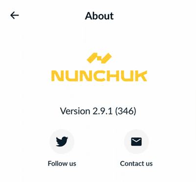

# Reproducible Builds

This page provides step-by-step instructions to build and verify that the version of the app downloaded from the Play Store matches the source code in our public repository.

## Step-by-step instructions

### 0. Prerequisites

Before you begin, ensure you have the following installed:

- `git`
- `docker` ([link](https://www.docker.com/))
- `curl`
- Java 17 or later
- [bundletool 1.18.3](https://github.com/google/bundletool/releases/tag/1.18.3)
- `adb` from [Android SDK Platform-Tools](https://developer.android.com/tools/releases/platform-tools)

Ensure `java`, `bundletool` and `adb` are on your `PATH`. Enable USB debugging and connect your phone for steps 4–5.

### 1. Confirm which version you have installed on your Android device

On the Nunchuk app, navigate to Profile > About. You should see the app version here:



In the above example, the app version is 2.9.1. The commit tag to check out the source code will be android.2.9.1.

### 2. Obtain the source code

Open Terminal, run the commands (replace `VERSION` with the version from step 1):

```bash
git clone https://github.com/nunchuk-io/nunchuk-android.git "$HOME/nunchuk-android"
cd "$HOME/nunchuk-android"
git checkout android.VERSION

# For our example, the command would be:
git checkout android.2.9.1
```

### 3. Build the app

```bash
# Build the Docker image
docker build --platform linux/amd64 -t nunchuk-android -f reproducible-builds/Dockerfile .

# Build the app
docker run --rm --platform linux/amd64 -v "$PWD":/app-src \
  --device /dev/fuse --cap-add SYS_ADMIN --security-opt apparmor:unconfined \
  nunchuk-android bash -c "mkdir /app && disorderfs --sort-dirents=yes --reverse-dirents=no /app-src /app && cd /app && ./gradlew clean :nunchuk-app:bundleProductionRelease"
```

After that's done, you have your app bundle! It's located in:

`./nunchuk-app/build/outputs/bundle/productionRelease/nunchuk-app-production-release.aab`

### 4. Generate the APKs from bundle

Now let's use bundletool to generate the set of APKs that should be installed on your device.

While your Android device is connected to your computer, run the following command to generate the APKs for that device:

```bash
mkdir -p apks
bundletool build-apks \
  --bundle=nunchuk-app/build/outputs/bundle/productionRelease/nunchuk-app-production-release.aab \
  --output-format=DIRECTORY --output=apks/built-apks --connected-device
```

Accept the USB debugging prompt on your phone. If the command reports an
unauthorized device, run it again after accepting.

### 5. Pulling the APKs from your device

With your Android device connected to your computer, run the following commands to pull Nunchuk APK files and store them in the `$HOME/nunchuk-android/apks/device-apks` directory:

```bash
mkdir -p apks/device-apks
adb shell pm path io.nunchuk.android | tr -d '\r' | sed 's/^package://' | xargs -I{} adb pull {} apks/device-apks/
```

Typical APK pairs are:

| Generated | Installed |
| --- | --- |
| `splits/base-master.apk` | `base.apk` |
| `splits/base-arm64_v8a.apk` | `split_config.arm64_v8a.apk` |
| `splits/base-xxhdpi.apk` | `split_config.xxhdpi.apk` |

The architecture and density names depend on your phone.

### 6. Checking if the APKs match

```bash
docker run --rm --platform linux/amd64 -v "$PWD":/app -w /app \
  nunchuk-android python3 reproducible-builds/apkdiff.py \
  apks/built-apks apks/device-apks
```

The script pairs the APKs automatically. `APKs are the same!` means you have
reproduced the installed app's code and resources from source.

If it prints `APKs are different!`, see [Troubleshooting](#troubleshooting).

## Verifying the GitHub release APK

If you download and install Nunchuk from the GitHub release page at https://github.com/nunchuk-io/nunchuk-android/releases, you can verify it directly with the bundle from [step 3](#3-build-the-app)

Save the downloaded APK as `apks/release.apk` in your checkout, then run:

```bash
docker run --rm --platform linux/amd64 -v "$PWD":/app -w /app \
  nunchuk-android python3 reproducible-builds/apkdiff.py \
  nunchuk-app/build/outputs/bundle/productionRelease/nunchuk-app-production-release.aab \
  apks/release.apk
```

## Verifying nunchuk-android-nativesdk (Advanced)

Our Android repository, `nunchuk-android`, uses `nunchuk-android-nativesdk` as a wrapper library to call functions from `libnunchuk`, a cross-platform C++ multisig library powered by Bitcoin Core.

We have prebuilt `nunchuk-android-nativesdk` in the repository [nunchuk-android-nativesdk-prebuild](https://github.com/nunchuk-io/nunchuk-android-nativesdk-prebuild). To build `nunchuk-android-nativesdk` yourself, you can follow these steps:

```bash
git clone https://github.com/nunchuk-io/nunchuk-android-nativesdk.git "$HOME/nunchuk-android-nativesdk"
cd "$HOME/nunchuk-android-nativesdk"

# Use the SDK version and prebuilt commit from the app release
SDK_VERSION=$(sed -n 's/^nativeSdk = "\([^"]*\)".*/\1/p' "$HOME/nunchuk-android/gradle/libs.versions.toml")
PREBUILD_COMMIT=$(sed -n 's/^prebuildNativeSdk = "\([^"]*\)".*/\1/p' "$HOME/nunchuk-android/gradle/libs.versions.toml")
git checkout "$SDK_VERSION"
git submodule update --init --recursive
```

Build the SDK:

```bash
docker run --rm --platform linux/amd64 -v "$PWD":/app -w /app \
  nunchuk-android bash -c "cd src/main/native && ./.install_deps.sh && cd /app && ./gradlew assembleArmRelease"
```

After that's done, you have your sdk .aar file! It's located in:

`./build/outputs/aar/nunchuk-android-nativesdk-arm-release.aar`

Download the prebuilt AAR used by the app and compare it:

```bash
curl -fL \
  "https://raw.githubusercontent.com/nunchuk-io/nunchuk-android-nativesdk-prebuild/$PREBUILD_COMMIT/nunchuk-android-nativesdk-arm8-release.aar" \
  -o prebuilt.aar
diff build/outputs/aar/nunchuk-android-nativesdk-arm-release.aar prebuilt.aar
```

No output from `diff` means the AAR files match.

## Troubleshooting

Add `--verbose` (or `-v`) to the comparison command to show compared files, notes,
differences and errors.

If you're able to successfully build and retrieve all of the APKs yet some of them are failing to verify, please check the following:

- Are you sure you're building the exact same version? Make sure you pulled the git tag that corresponds exactly with the version of Nunchuk you have installed on your device.
- The same phone was used to generate and pull the APKs.
- The APKs were generated with bundletool 1.18.3. Other versions can change the generated manifests.
- The output directories contain only files from this comparison.
- The Docker image was built from that release's Dockerfile.

If you're having trouble even after building and pulling all the APKs correctly and trying the troubleshooting steps above, please [open an issue](https://github.com/nunchuk-io/nunchuk-android/issues/new/choose).
Include the app version, phone model and comparison output.
